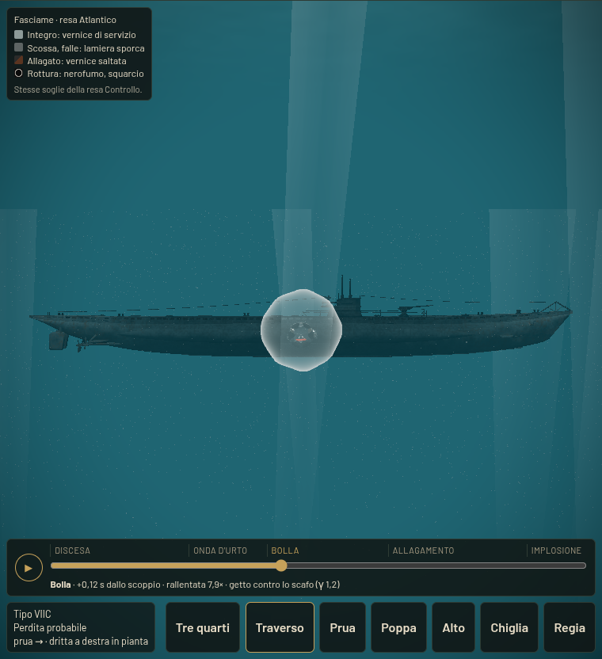
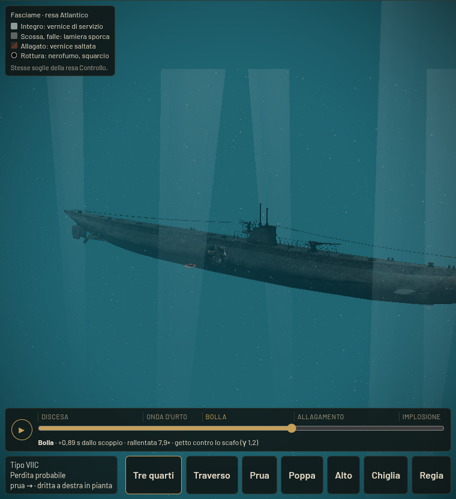
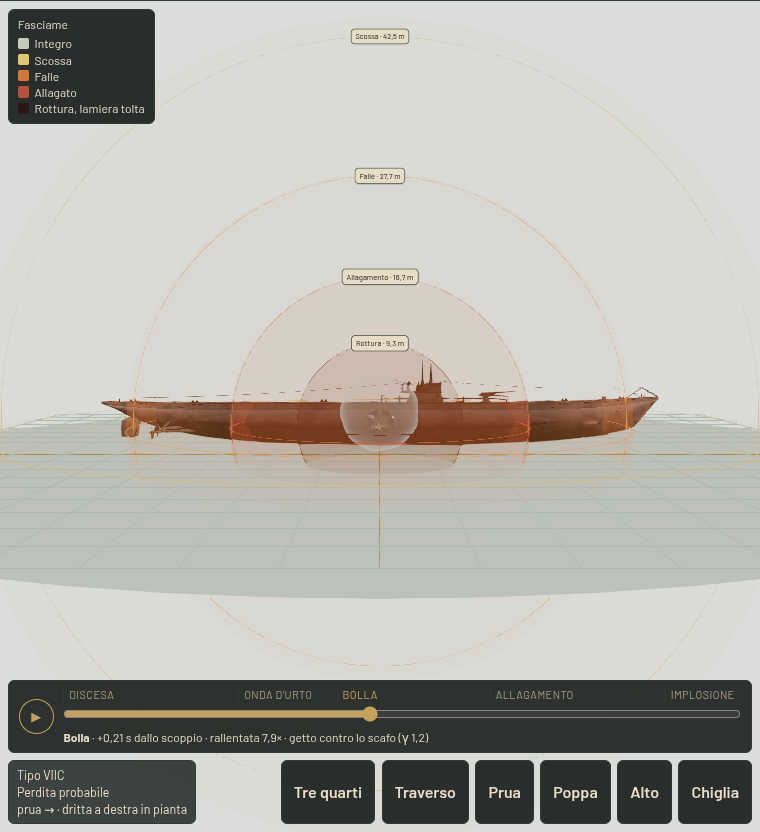
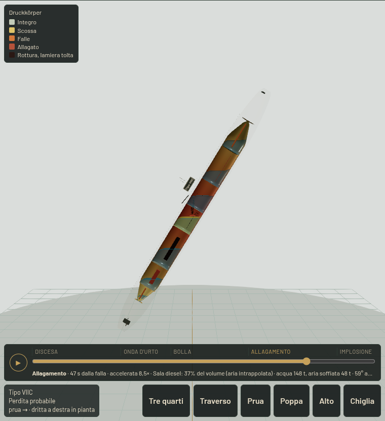
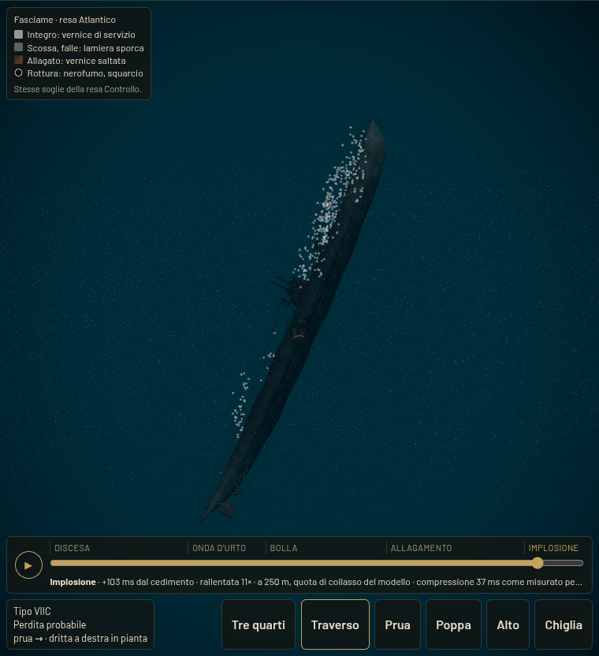
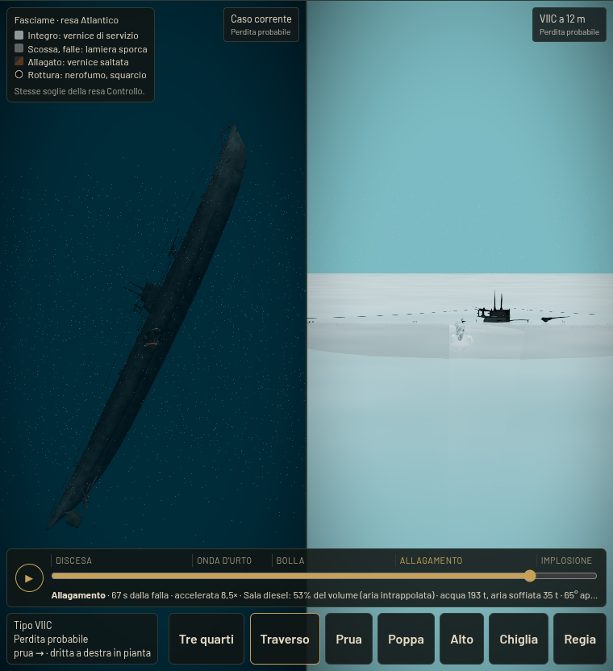
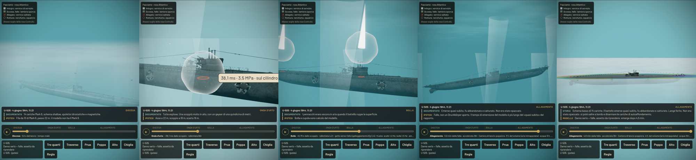
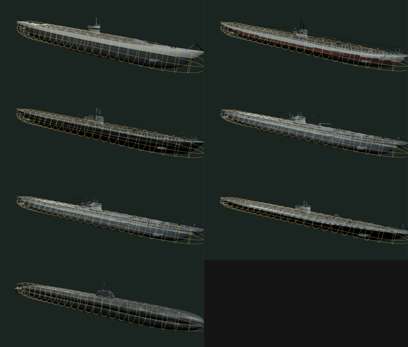
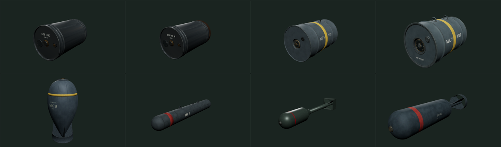

# ABISSO

**Studio analitico del danno da carica di profondità sugli U-Boot della seconda guerra
mondiale** (Atlantico settentrionale, 1939–1945).

Un modello fisico costruito sulla letteratura aperta, una scena 3D che ricostruisce nel
tempo lo scoppio e le sue conseguenze, e un archivio di casi storici in cui ciò che è
documentato resta sempre separato da ciò che è ipotesi.

**Online: <https://timrouter.dns.army/abisso/>**



> Modello di studio, non strumento operativo. Ogni formula dichiara la sua fonte e il suo
> stato: *verificata*, *ricostruita* o *non trovata*. Il verdetto è un indice calibrato su
> una stima d'epoca, non una previsione.

## Che cosa fa

- **Calcola** il danno di una o più cariche su un battello: picco di pressione, impulso,
  raggio di rottura scalato su carica, scafo e quota, livello di danno per compartimento.
- **Ricostruisce nel tempo** discesa delle cariche, onda d'urto, bolla di gas con getto e
  frusta dello scafo, allagamento, assetto, emersione o implosione. Ogni fase ha la sua
  scala temporale (millisecondi, decimi di secondo, minuti), dichiarata sulla barra.
- **Mostra il danno sullo scafo**: ammaccature, lamiera che rientra fra le ordinate,
  squarci a petali, detriti che affondano o risalgono, acqua nei locali, carico sulle
  paratie, cloro nelle batterie, nafta in superficie.
- **Confronta** due casi affiancati con la stessa camera e la stessa barra del tempo.
- **Ricostruisce casi storici** (U-99, U-110, U-175, U-202, U-505, U-736) con camera
  guidata e, fase per fase, una riga *Documentato* e una riga *Ipotesi*.
- **Esporta** immagini PNG e sequenze WebM, tutto nel browser.

## Galleria

| | |
|---|---|
|  |  |
| Resa *Atlantico*: acqua, luce e particelle cambiano con la quota. | *Soglie di danno*: rottura, allagamento, falle e scossa attorno alla carica. |
|  |  |
| Acqua nei locali con il pelo libero orizzontale, battello a 59° di assetto. | Oltre la quota di collasso: sezioni schiacciate fra le campate e nube d'aria. |

**Confronto affiancato**: lo stesso VIIC colpito a 8 m (affonda) e a 12 m (emerge).



**Caso storico**: U-505, 4 giugno 1944, cinque momenti della ricostruzione guidata.



**Archivio dei modelli**: cinque famiglie di battelli (IIB, VIIC, IXC, XB, XXI, con le
varianti del 1944) e nove ordigni (Mark VII, Mark VII Heavy, Mark X, US Mark 6, 7 e 9,
Hedgehog, Squid).

|  |  |
|---|---|

## Avvio

Serve Node.js 22 o successivo.

```bash
npm install
npm run dev        # http://localhost:8080
npm test           # 70 test: calibrazione, catalogo, fisica, casi storici
npm run build      # controllo dei tipi + sito statico in dist/
npm run smoke      # screenshot headless (richiede `npm run preview` attivo)
```

Il build è un sito statico con base relativa: si serve da qualunque cartella. I font sono
ospitati localmente, senza risorse esterne a runtime. L'interfaccia è in italiano ed è
pensata per PC.

## Il modello fisico

| Fenomeno | Formula o dato | Fonte | Stato |
|---|---|---|---|
| Picco di pressione | similitudine di Cole, 52,16 MPa, esponente 1,13 | Cole 1948 | verificato |
| Raggio di rottura | 6,1 m per il Mark VII su un VIIC a 75 m | stima della Royal Navy | calibrazione |
| Bolla: raggio massimo | 3,50 · W^⅓ / (d + 10)^⅓ | Swisdak 1978 | verificato |
| Bolla: cicli e risalita | rapporti di periodo e raggio; 12,3 √W / (d + 10) | Riley 2010, Brainard 2015 | √W ricostruito |
| Getto della bolla | anisotropia ζ = 0,195 γ⁻², somma vettoriale con il galleggiamento | Supponen et al. 2016 | verificato |
| Frusta dello scafo | primo modo libero–libero, massa virtuale 2 × dislocamento | Yin et al. 2014, Stettler 1995 | ampiezza illustrativa |
| Lamiera fra le ordinate | δ/H = 0,506 φ − 0,158 | Nurick–Martin, Yuen et al. 2017 | estrapolato |
| Spessori e ordinate | VIIC 22 mm, passo 600 mm; IXC/40 18 mm; XXI 26/18 mm | ONI 1941 (U-570), Portsmouth 1946 | verificato |
| Assetto in immersione | Δ · BG · tan θ = w · x | USNA EN400 | BG stimato |
| Aria compressa | VIIC: 12 bombole da 325 l a 205 at | M.Dv. 371,181 (1940) | verificato |
| Risalita della nafta | legge di Johansen, 7,6 cm/s per gocce di 2 mm | Nordam et al. 2020 | diametro ipotizzato |
| Implosione | compressione in 37 ms | Rule 2018 (USS Scorpion) | forma di resa |

Le fonti complete, con pagine e collegamenti, sono in:

- [`docs/FONTI-RISPOSTA.md`](docs/FONTI-RISPOSTA.md): bolla, getto, frusta, superficie
- [`docs/FONTI-LAMIERA.md`](docs/FONTI-LAMIERA.md): lamiera, ordinate, spessori, petali
- [`docs/FONTI-CONSEGUENZE.md`](docs/FONTI-CONSEGUENZE.md): acqua, assetto, cloro, nafta, implosione
- [`docs/PIANO-MOTORE-DANNI.md`](docs/PIANO-MOTORE-DANNI.md): piano delle fasi e stato

### Limiti dichiarati

- La distanza fra baricentro e centro di carena degli U-Boot non è stata trovata: gli
  assetti grandi dipendono da una stima.
- I 250 m di collasso del VIIC non hanno conferma in un documento d'epoca.
- Nessun tasso di produzione del cloro: la nebbia nei locali batterie è solo resa.
- La condotta dell'equipaggio (quando soffia le zavorre) è un'ipotesi.
- Negli eventi storici lo scarto in metri quasi mai è documentato: è scelto dal modello,
  e la scheda lo dice.
- Non sono modellati pompe di sentina, timoni di profondità, artiglieria, armi aeree.

## Struttura

| Percorso | Contenuto |
|---|---|
| `src/sim/model.ts` | Modello di danno: Cole, bolla, raggio di rottura, livelli, allagamento |
| `src/sim/timeline.ts` | Linea del tempo: tempo reale ↔ tempo a schermo per fase |
| `src/sim/response.ts` | Getto della bolla, cicli, frusta dello scafo, effetti in superficie |
| `src/sim/plate.ts` | Lamiera fra le ordinate, numero di danno, petali |
| `src/sim/hydrostatics.ts` | Peso, assetto, soffiatura, caduta, emersione, implosione |
| `src/sim/shape.ts` | Geometria parametrica degli scafi per famiglia |
| `src/render/` | Shader del danno, acqua, post-processing, effetti, esportazione |
| `src/components/abisso/` | Interfaccia: pannelli, scena (React Three Fiber), archivio, metodo |
| `src/data/` | Battelli, ordigni, eventi storici, batterie, struttura interna |
| `public/models/` | Modelli 3D in formato GLB, con provenienza in `README.md` |
| `public/archive/` | Tavole e fotografie d'archivio di dominio pubblico |
| `tests/` | `node:test` con alias `@/` (vedi `tests/alias.mjs`) |
| `scripts/` | Smoke test e screenshot headless con Chromium |

## Tecnologie

Vite 8, React 19, TypeScript, three.js con React Three Fiber e drei, postprocessing,
zustand, Recharts, Tailwind 4. Il danno è disegnato in shader sul materiale standard
(`onBeforeCompile`), con una copia GLSL della curva degli effetti confrontata nei test
con quella del modello.

## Origine e crediti

- La prima versione è nata come prototipo in Grok App Builder; qui è stata estratta in
  un sito statico e poi estesa (motore del danno, ricostruzione nel tempo, conseguenze,
  lettura analitica, casi storici).
- I modelli 3D di battelli e ordigni sono stati generati con
  [Thrixel](https://thrixel.com) a partire da descrizioni e piani d'epoca; non sono
  rilievi e hanno difetti noti, elencati in `public/models/README.md`.
- Le fotografie d'archivio sono di dominio pubblico (US Navy, Imperial War Museums con
  Crown Copyright scaduto); le didascalie nell'app riportano la collocazione.
- Sviluppo assistito da Claude Code.

## Licenza

Il codice è software libero, distribuito con licenza
[GNU General Public License versione 3](LICENSE) o successiva (GPL-3.0-or-later): si può
usare, studiare, modificare e ridistribuire, a patto che le versioni derivate restino sotto
la stessa licenza. È fornito senza alcuna garanzia.

Le fotografie in `public/archive/` sono di dominio pubblico e non sono coperte dalla
licenza del codice; le didascalie nell'app ne riportano la collocazione.
